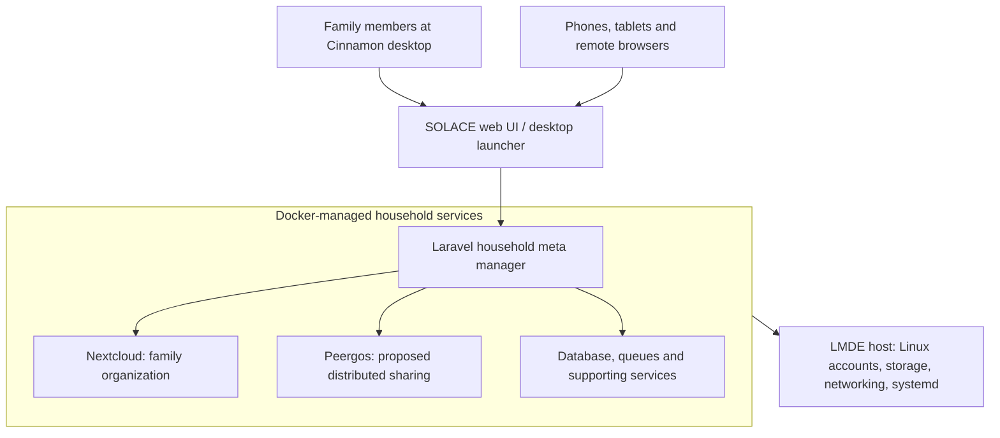

# SOLACE Network Hardware

## 1. Purpose

SOLACE Network aims to support affordable, energy-efficient, and interoperable hardware that households and neighborhoods can operate themselves.

The long-term objective is to help communities build and maintain their own computing and communication infrastructure without depending exclusively on commercial service providers or proprietary equipment.

This document describes the proposed hardware architecture, device terminology, reference configurations, power considerations, and future implementation requirements.

It is a planning document, not a finalized hardware specification.

**No specialized SOLACE hardware is required during Phase 1.**

Hardware development becomes a primary focus in Phase 2, when households can begin hosting local applications and services.

## 2. Hardware Philosophy

SOLACE Network is intended to be vendor-neutral.

Rather than developing an entirely proprietary equipment ecosystem, the project seeks to integrate existing hardware and open-source software using published compatibility requirements and tested reference configurations.

The guiding principles are:

- **Bring your own device:** Participants should be able to use suitable equipment they already own.
- **Open standards:** Hardware and software should communicate through documented, interoperable interfaces.
- **Affordability:** Minimize the cost of participating and operating household infrastructure.
- **Energy efficiency:** Favor low-power equipment capable of operating continuously.
- **Repairability:** Prefer equipment with replaceable components and accessible documentation.
- **Modularity:** Allow participants to add or replace components according to their needs.
- **Local ownership:** Household infrastructure should remain under the control of the people operating it.
- **Optional official equipment:** SOLACE reference hardware should never be the only supported implementation.

SOLACE may eventually publish compatible-component lists, assembly instructions, reference images, and tested configurations.

The project should avoid unnecessary hardware vendor lock-in.

## 3. Hardware Terminology

### 3.1 SOLACE Home Device (SHD)

An **SHD** is a computer providing household-level SOLACE services.

This is a functional classification rather than a particular brand or model.

An SHD might be a small low-power computer, a repurposed desktop or laptop, a single-board computer, or other suitable hardware.

The device may host local applications, data storage, and network services.

An SHD may use official SOLACE software or a compatible independent implementation.

### 3.2 SOLACE OS (SOS)

**SOS** refers to the official SOLACE operating-system distribution or reference implementation.

The initial concept is based on Linux Mint Debian Edition (LMDE), customized with SOLACE software and configuration.

An eventual SOS installation image could simplify deployment and provide a known reference environment.

Running SOS is not required for an otherwise compatible SHD.

### 3.3 SOLACE Compatible Device (SCD)

An **SCD** is an independently assembled or third-party device that satisfies the relevant SOLACE compatibility requirements.

For example, a participant might install the required services on an existing Debian or Ubuntu computer instead of using an official SOS installation.

Compatibility should depend on supported functionality and adherence to published interfaces, not simply on the brand of equipment.

### 3.4 Other device roles

The architecture may also involve:

- **Network routers:** Equipment connecting household devices and future neighborhood networks.
- **Mesh radios or access points:** Wireless equipment used to establish communication between participating locations.
- **Personal devices:** Smartphones, tablets, laptops, and desktop computers running SOLACE applications.
- **Sensors:** Optional devices supplying environmental, household, or research measurements.
- **Gateways:** Devices or services connecting separate network segments or supporting external connectivity.

These roles may be implemented by separate devices or combined where practical.

## 4. Hardware Across the Four Phases

### Phase 1 — Centralized Applications

No SOLACE-specific household hardware is required.

Participants access applications hosted on the central SOLACE Server using ordinary computers, smartphones, tablets, and web browsers.

Some applications may support Progressive Web App installation and local storage.

The Phase 1 focus is software development, account registration, household and neighborhood membership, and initial applications.

### Phase 2 — Household Computing

Phase 2 introduces the SHD as an important part of the SOLACE architecture.

Households may deploy a locally operated computer that hosts applications, databases, storage, and supporting services.

Personal devices can communicate with these services over the household's existing network.

The SHD initially relies on the central SOLACE Server for communication with other households.

Hardware priorities include:

- Establishing minimum and recommended SHD requirements.
- Developing and testing the official SOS reference installation.
- Supporting suitable third-party Linux equipment.
- Packaging local services for consistent deployment.
- Defining installation, maintenance, backup, and recovery procedures.
- Evaluating power consumption and reliability during continuous operation.
- Establishing connectivity and status-reporting mechanisms.

Phase 2 does not require neighborhood mesh equipment.

### Phase 3 — Hybrid Mesh Networking

Phase 3 introduces direct networking between participating households.

OpenWrt-compatible networking equipment was identified as a preferred starting point for experimentation.

The intended architecture allows SHDs to communicate through supported neighborhood network links while retaining access to the central server when available.

Hardware research will need to address:

- Compatible routers and wireless access points.
- Suitable antennas and installation configurations.
- Wireless range, interference, and link reliability.
- Local routing and network isolation.
- Power requirements for networking equipment.
- Guest connectivity.
- Compatibility across different household installations.

Specific wireless standards, equipment requirements, frequencies, and routing protocols have not yet been selected.

### Phase 4 — Independent Decentralized Networking

Phase 4 aims to support independent household and neighborhood communication without requiring the central SOLACE Server.

Compatible community-operated gateways and other infrastructure may supplement local networks.

Future hardware may support more sophisticated connectivity, distributed network monitoring, and links between geographically separated neighborhoods.

The existing central server may remain available as an optional gateway.

Phase 4 hardware specifications will depend on lessons learned during earlier phases.

## 5. Proposed SHD Reference Architecture

The initial SHD concept uses a conventional computer running a Linux-based operating system.

Its primary role is to provide locally hosted services rather than high-performance graphics or gaming capabilities.

### 5.1 Computing priorities

Earlier discussions emphasized:

- Low power consumption.
- Reliable continuous operation.
- Adequate storage for applications and household data.
- Sufficient memory for local services.
- Standard networking interfaces.
- Compatibility with Linux and containerized software.
- Reasonable acquisition and replacement costs.

Storage capacity and dependable operation are generally more important than graphics performance for the baseline SHD.

Actual CPU, memory, and storage requirements remain to be established through testing.

### 5.2 Reference operating system

The planned official implementation uses a customized LMDE installation.

The operating system provides:

- Hardware and driver support.
- Local networking.
- System services.
- Device administration.
- Security updates.
- Storage and filesystem management.
- Support for locally hosted application containers.

Other Linux distributions may be compatible when they provide the required services and interfaces.

### 5.3 Local service deployment

Docker and Docker Compose were discussed as methods for packaging and operating SHD services.

The planned service environment may include:

- Laravel/PHP application services.
- MariaDB.
- HTTP serving or reverse-proxy components.
- SOLACE network and household APIs.
- Optional Nextcloud services.
- Optional Kiwix or offline reference resources.

The host operating system remains responsible for hardware management, networking, and other system-level functions.

Containerization makes software deployment more portable but does not automatically solve connectivity, routing, or security issues.

### 5.4 Data storage

An SHD should be able to preserve household applications and data locally.

Potential storage uses include:

- Household application databases.
- Shared documents.
- Educational materials.
- Offline knowledge resources.
- Research observations.
- Local backups.

Storage requirements may vary considerably depending on which optional services are installed.

Persistent storage, backup procedures, filesystem reliability, and data recovery require further specification.

### 5.5 Optional local AI

A long-term concept involves a more powerful neighborhood computer hosting a local language model.

Such a system might support collaborative research, shared-document analysis, technical troubleshooting, and other community tasks.

Earlier discussions considered a dedicated, substantially more expensive GPU-equipped server, potentially around $5,000, as an optional neighborhood resource.

This is not part of the baseline SHD requirements.

Detailed AI hardware and service specifications are deferred.

## 6. Household Network Equipment

### 6.1 Router

The initial hardware concept separates the SHD computer from the household router.

A compatible router may run OpenWrt or another suitable system.

During Phase 2, the SHD can connect through the household's existing local network and internet connection.

During Phase 3, additional wireless networking equipment may support direct connections between participating households.

A combined SHD/router device may be possible in a future reference design.

### 6.2 Wireless equipment

Potential neighborhood wireless installations may require access points, antennas, and appropriate mounting or power equipment.

The correct configuration will depend on terrain, building placement, distances, interference, and applicable radio regulations.

No universal antenna or router configuration has been selected.

### 6.3 Mesh radio systems

We also discussed independent low-bandwidth radio networks, including Meshtastic, MeshCore, and MeshOS-related devices and software.

These systems were considered as potential complementary communication channels.

Possible future roles include:

- Limited text communications.
- Household or member-associated radio identities.
- Communication during internet outages.
- Additional paths between participating network segments.

Such integrations require separate technical evaluation.

A radio device should not automatically be treated as equivalent to a full SHD.

## 7. Power and Energy Resilience

SOLACE's long-term vision includes equipment capable of operating efficiently and, where practical, independently of the electrical grid.

### 7.1 Power priorities

Earlier discussions emphasized:

- Low-power equipment.
- Battery backup.
- Renewable energy.
- Modular power components.
- Replaceable batteries.
- Reduced dependence on fuel-powered generators.

Continuous operation should not require expensive or elaborate power systems for every household.

### 7.2 Reference power architecture

The conceptual hardware arrangement includes:

- An SHD computer.
- A router or communications device.
- Battery storage.
- Appropriate charging and power-control equipment.
- Optional renewable charging sources.

Earlier discussions considered separate battery packs for individual components rather than relying exclusively on one large centralized battery.

This could permit selective shutdown, replacement, or hot-swapping of components.

Safe electrical design, charging protection, and compatible voltage requirements must be established before any reference power system is recommended.

### 7.3 Existing battery ecosystems

One idea was to reuse existing commercial power-tool battery ecosystems where technically suitable.

A compatibility reference might identify supported batteries by manufacturer and part number.

Any implementation would require appropriate voltage conversion, protection, and charging equipment.

Compatibility should not be assumed merely because connectors or voltages appear similar.

### 7.4 Renewable power

Potential conventional power sources discussed include:

- Solar photovoltaic systems.
- Small wind systems.
- Micro-hydroelectric systems where appropriate.

Solar generation and battery storage are candidates for early evaluation because commercial equipment is readily available.

No SOLACE-specific renewable power system has been finalized.

Experimental energy-generation methods are documented separately in `SOLACE_SCIENTIFIC_RESEARCH_TOPICS.md`.

## 8. Displays and User Interfaces

A long-term interest involves low-power displays.

Earlier concepts included a hybrid LED/e-ink display that could combine the visibility and refresh characteristics of a conventional screen with lower-power static information display.

A practical interim solution could use an ordinary low-power monitor supplemented by a small e-ink status display.

These ideas remain exploratory.

An SHD should not be assumed to require a dedicated display for ordinary operation.

## 9. Network Status Indicators

Earlier branding and hardware discussions included the idea of a SOLACE status indicator integrated into the device enclosure.

One proposal uses an illuminated lens behind a cutout of the SOLACE symbol.

Suggested status colors were:

- **Green:** Internet connectivity available.
- **Yellow:** Local neighborhood connectivity available.
- **Red:** Low battery or emergency-only communication mode.

This is a proposed visual convention rather than a finalized signaling standard.

A software network-status indicator may also appear in SOLACE applications.

The underlying status information should distinguish actual connectivity and service availability from mere proximity to wireless equipment.

Detailed connectivity monitoring belongs in `NETWORK_OVERVIEW.md`.

## 10. Compatible Hardware and Reference Kits

The project may eventually publish reference hardware lists and optional kits.

An illustrative comprehensive household kit discussed previously could include:

- SHD computer.
- Network router.
- Wireless equipment and antenna.
- Battery backup.
- Associated power and connectivity components.

An approximate $1,000 target was explored for a more complete optional kit, not established as a required budget or product price.

Lower-cost and self-assembled participation should remain possible.

Some households might participate using only a compatible personal device or radio system, depending on available services and the network phase.

### 10.1 Reference configurations

SOLACE could publish tested hardware configurations at several capability levels.

Potential categories include:

- Minimum compatible household computer.
- Recommended household SHD.
- SHD with extended local storage.
- SHD with battery-backed operation.
- SHD plus neighborhood mesh equipment.
- Optional enhanced systems for specialized community services.

Specific hardware models and minimum specifications have not been selected.

### 10.2 Compatibility documentation

A future hardware compatibility list might identify:

- Manufacturer and model.
- Hardware capabilities.
- Tested operating systems.
- Required software versions.
- Power requirements.
- Known limitations.
- Installation instructions.

The goal is to make compatible equipment easier to select and maintain.

## 11. Device Branding

Official SOLACE-branded devices and compatible third-party equipment should be clearly distinguishable.

The original branding discussions considered reserving certain official device marks, including the cutout SOLACE symbol, for authorized reference equipment.

Third-party products could use descriptive compatibility labeling such as:

**Compatible with SOLACE Network**

Compatibility should be determined by published requirements rather than branding alone.

Detailed trademark and visual identity policies belong in `BRANDING_AND_MARKETING.md`.

## 12. Phase 2 Hardware Priorities

Phase 2 represents the first major hardware-related stage of SOLACE development.

The initial work should concentrate on a manageable reference SHD rather than attempting to design a complete hardware product line.

Proposed priorities:

1. Establish an initial baseline SHD configuration using available computer hardware.
2. Determine minimum practical CPU, memory, storage, and networking requirements.
3. Develop and test the customized SOLACE OS installation.
4. Package required local services for consistent deployment.
5. Confirm operation on at least one compatible non-reference Linux installation.
6. Establish local application access from household devices.
7. Develop secure SHD registration and communication with the central server.
8. Test data persistence, backup, recovery, and software updates.
9. Measure power consumption and continuous-operation reliability.
10. Publish reference installation instructions and compatibility documentation.

These are planning objectives rather than finalized release requirements.

Advanced batteries, specialized enclosures, radio networking, and decentralized connectivity should not block the first SHD proof of concept.

## 13. Open Questions

### Computing

- What minimum SHD specifications are practical?
- Which CPU architectures should be supported?
- Will a headless installation be the default?
- How will software updates be distributed and installed?
- What backup and recovery model will be recommended?

### Networking

- Which router and wireless equipment should be used for early experiments?
- What requirements define a compatible SHD?
- How will SHDs register and authenticate with central services?
- What separation is required between private household networks and guest or mesh traffic?

### Power

- What operating-time targets should battery backup provide?
- Should independent component batteries be preferred over a shared supply?
- Which existing battery systems are suitable for tested configurations?
- What minimum electrical safety requirements should apply?

### Manufacturing and distribution

- Will SOLACE eventually assemble reference hardware?
- Which equipment should be offered as optional kits?
- How should third-party compatibility be verified?
- How can hardware instructions remain accessible to nontechnical participants?

## Proposed SOS Family Desktop and Appliance Experience

The SOS reference installation is envisioned as a **usable household computer as well as a continuously operating network node**. LMDE with Cinnamon is the preferred starting point for the reference desktop, rather than assuming every SHD is a headless server. A headless or third-party Linux installation may still be compatible.

The intended end-user sequence is: **Download → Write installation media → Install → Set up → Log in → Share**. A future SOS installation image could bundle tested configurations, Docker/Compose service definitions, first-run configuration, and desktop launchers. This is a distribution goal, not a claim that an installable SOS ISO exists today.

### Host and service separation

Services should start independently of any Cinnamon login, recover after reboot, and preserve data outside disposable container layers. Container updates, migrations, backup/restore, and service health checks require tested procedures. Host and container permissions must prevent ordinary desktop users from gaining infrastructure administration rights; membership in the Docker group is effectively privileged.

### Linux accounts versus SOLACE identities

All household members are expected to have SOLACE accounts, but **not all members need Linux desktop accounts**. The Head of Household may administer the host, while other desktop users have ordinary Linux accounts. SOLACE application authorization is separate from Linux login privileges.

An optional restricted, disposable Linux guest session could permit someone to open a browser and authenticate to their *own* SOLACE account, reaching their home services through the network. The guest session must not inherit the host household's credentials; temporary browser data should be cleared. Disposable guest-session behavior requires explicit implementation and testing rather than assuming LMDE provides it automatically.

### Reference lab and validation

An initial reproducible lab could use two Linux mini PCs and two OpenWrt-compatible routers to simulate separate households, first on isolated LANs and later at separate physical sites. Record hardware revisions, software versions, installation steps, expected results, recovery procedures, and actual measurements. The first reference neighborhood should be a **tested example**, not mandatory hardware.

Test local usability, service restart after logout/reboot, resource usage, upgrades, backups, power consumption, and progressively more severe connectivity and power interruptions. Battery-backed networking is a possible future capability, not a baseline requirement.

---

## 14. Related Documentation

- [Network Overview](NETWORK_OVERVIEW.md) — Network evolution, connectivity, and distributed infrastructure.
- [Vision](VISION.md) — Community resilience, local independence, and long-term goals.
- [Identity and Governance](IDENTITY_AND_GOVERNANCE.md) — Household, member, and neighborhood identities.
- [Roadmap](ROADMAP.md) — High-level development stages.
- [Branding and Marketing](BRANDING_AND_MARKETING.md) — SOLACE device identity and compatibility branding.
- [Scientific Research Topics](SOLACE_SCIENTIFIC_RESEARCH_TOPICS.md) — Experimental energy and scientific research ideas.
- [Parking Lot](PARKING_LOT.md) — Deferred product and software ideas.