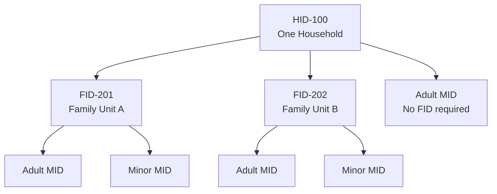

# Identity and Governance

## 1. Purpose

SOLACE Network is organized around individual members, households, and neighborhoods.

The identity system provides a foundation for membership, applications, community participation, and future decentralized communication.

The governance model is intended to give participating households an equal voice while allowing neighborhoods to organize and manage their own affairs.

Development will proceed incrementally. Phase 1 establishes basic identities, account management, and membership relationships. More advanced cryptographic authentication and decentralized governance mechanisms can be introduced in later phases.

## 2. Identity Structure

SOLACE recognizes three primary levels of identity.

| Identifier | Entity | Description |
|---|---|---|
| MID | Member | An individual person participating in SOLACE |
| HID | Household | A household containing one or more members |
| FID | Family | Guardian–minor family unit associated with a household |
| NID | Neighborhood | A community of participating households |

These identifiers remain associated with their respective entities throughout their lifetimes.

Identifiers should be independent of display names, email addresses, devices, passwords, and cryptographic keys, all of which may change.

### 2.1 Members (MID)

An MID represents an individual SOLACE member.

Members may access applications, participate in household activities, and exercise permissions granted through their household or neighborhood.

Membership accounts initially use centrally managed authentication.

### 2.2 Households (HID)

An HID represents a household rather than a particular person or computer.

A household may:

- Contain multiple members.
- Have an authorized Head of Household.
- Operate one or more SOLACE Home Devices.
- Participate in a neighborhood.
- Exercise one household vote in eligible neighborhood decisions.

The number of people or devices associated with a household does not increase its voting weight.

### 2.2.3 Family Relationships (FID)

An **FID (Family Identifier)** represents a family or guardianship unit used to establish responsibility for minors within SOLACE Network.

The primary purpose of FID is to associate members under the age of 18 with their parent or legal guardian so that account permissions, parental controls, and responsibilities can be managed appropriately.

The term *family* does not imply a biological relationship. A guardian may be a biological parent, adoptive parent, or another legally recognized guardian.

The following principles apply:

- **Minors:** Every MID belonging to a member under 18 must be associated with an FID that includes at least one responsible adult guardian MID.
- **Guardians:** An adult guardian is associated with the FID and has an explicitly defined role and authority over the minor's account.
- **Adults:** Adult members who do not have minors under their guardianship do not require an FID.
- **Households:** An HID may contain multiple independent FIDs, and not all household members must belong to an FID.
- **Voting:** FID relationships do not create additional household voting rights. Voting remains based on eligible HIDs.

The original `solace-main` Laravel prototype introduced a `families` table with an FID primary key and a `family_user` pivot table that associates individual members with family units and their roles.

The FID structure provides the foundation for applying age-appropriate permissions and identifying which authorized adult members are responsible for managing a minor's SOLACE account.

Specific guardianship verification procedures, parental permissions, and account transitions when a minor turns 18 will be defined separately.

### 2.2.4 Minor Account Registration

Members under the age of 18 cannot independently register for SOLACE Network.

A minor's account must be created by an authorized adult parent or legal guardian who is already a SOLACE member.

The following requirements apply:

- **No self-registration:** Members under 18 cannot create their own independent SOLACE accounts.
- **Existing household:** A minor must be added to an existing HID.
- **Required family association:** Every minor MID must belong to an FID that includes at least one adult guardian MID.
- **Guardian authorization:** The adult adding the minor must be authorized to act as the minor's parent or legal guardian.
- **Separate identities:** Minors receive their own MIDs rather than sharing their guardian's account.
- **Guardian permissions:** Account management and age-appropriate permissions are associated with the minor's FID and authorized guardian MID.
- **Household independence:** The Head of Household does not automatically receive legal guardianship authority over minors belonging to other family units within the same HID.

When a member turns 18, their MID remains unchanged. The member may transition to an independently managed adult account without losing their existing identity or membership history.

The precise guardian-verification process, age-transition workflow, and parental permission settings will be specified during implementation.

### Example household structure

### 2.3 Neighborhoods (NID)

An NID represents a SOLACE neighborhood.

Neighborhoods are intended to be geographically organized communities of households.

Neighborhood boundaries may eventually be represented through mapping or geographic data.

A neighborhood may have a Captain responsible for routine administration and coordination.

Exact geographic membership and boundary-verification rules have not yet been finalized.

Detailed rules for neighborhood creation, geographic boundaries, household eligibility, invitations, and transfers are documented in [Neighborhood Membership](NEIGHBORHOOD_MEMBERSHIP.md).

## 3. Initial Membership and Leadership

### 3.1 Creating a household

The member who initially creates a household becomes its first Head of Household.

The Head of Household is responsible for initial household administration and may authorize other household members according to established permissions.

The household's identity remains separate from the individual serving as Head of Household.

### 3.2 Creating a neighborhood

The member who initially creates a neighborhood becomes its first Neighborhood Captain.

The Captain may coordinate initial neighborhood administration and community organization.

A Captain's authority comes from an assigned administrative role and does not imply permanent personal ownership of the neighborhood.

### 3.3 Changing leadership

Household and neighborhood identities must survive changes in their administrators.

Earlier planning proposed requiring unanimous HID consent to replace a Neighborhood Captain.

The precise procedures for succession, resignation, inactivity, emergencies, and disputed changes remain to be defined.

These questions do not need to be completely resolved before establishing the Phase 1 membership model.

## 4. Household Representation and Voting

### 4.1 One household, one vote

The foundational governance principle is:

**Each eligible HID has one equal vote.**

Voting weight is not increased by:

- The number of MIDs within a household.
- The number of devices operated.
- The amount of computing or network infrastructure contributed.
- The length of time the household has participated.

A newly registered eligible HID has the same voting standing as an established eligible HID.

### 4.2 Neighborhood decisions

Neighborhoods may eventually distinguish between routine administrative actions and decisions requiring household approval.

Possible approval models discussed include simple majority, supermajority, and unanimous consent, depending on the significance of the decision.

The exact thresholds, quorum requirements, eligibility rules, and voting procedures remain future governance work.

### 4.3 Household voting authorization

Because voting rights belong to the HID rather than an individual member, the system must eventually determine which authorized member or members may cast the household's vote.

The Head of Household is an initial administrative role, but detailed delegation and household representation rules remain to be determined.

## 5. Household Activity and Inactive Status

SOLACE recognizes that participation is not limited to interactive website activity.

A household may contribute to the network by operating an authorized SHD, even when none of its members has logged into the central server recently.

### 5.1 Qualifying activity

Potential qualifying activity includes:

- Authenticated member account activity.
- Operation of an authorized SHD, demonstrated through verified network status reporting.
- Other approved forms of participation.

Network participation and human account activity should be measurable separately.

### 5.2 Extended inactivity

An HID may eventually be marked temporarily inactive following an extended period without qualifying participation.

Before a status change, SOLACE may notify the household through email or other available communications and provide an opportunity to resume participation.

The intention is to encourage participation rather than penalize households for occasional absence.

Inactive status should not automatically delete an HID, its membership history, or associated data.

### 5.3 Reactivation

A household should be able to regain active status through an established authentication or reactivation process.

Automatic reactivation following qualifying activity was discussed as the preferred direction, but the complete policy has not yet been adopted.

### 5.4 Fairness and network outages

Inactivity rules should be objective, published, and consistently enforced.

A Neighborhood Captain should not be able to arbitrarily change household activity status to manipulate voting eligibility.

Internet outages, mesh disconnections, and other infrastructure failures must be considered when determining inactivity.

The specific inactivity period, warning schedule, grace period, and effect on voting eligibility remain undecided.

## 6. Foundation-Level Governance

The proposed SOLACE Foundation would steward the broader network, coordinate development, and support shared infrastructure and community scientific activities.

The long-term governance vision includes representation by participating households and an elected, term-limited board.

Foundation governance is distinct from neighborhood governance.

The Foundation's eventual legal structure, board election procedures, voting eligibility, and authority over network standards require separate development.

## 7. Future Cryptographic Identity

**Status: Proposed architecture, not a finalized Phase 1 implementation requirement.**

Earlier planning explored generating cryptographic public/private key pairs for MIDs, HIDs, and NIDs.

The goal is to establish identities that can eventually be authenticated independently of the central SOLACE Server.

### 7.1 Identity and keys

Persistent entity identifiers should remain independent of their cryptographic keys.

Keys may need to be added, replaced, revoked, or recovered without changing the MID, HID, or NID.

A member, household, or neighborhood may eventually have multiple authorized keys or credentials.

### 7.2 Key creation and protection

The proposed approach is to generate private keys on trusted user devices rather than on the central server.

Public verification information may be registered with the central service during the early phases.

Private keys should not be routinely transmitted to or stored by the central server.

The precise cryptographic algorithms, registration procedures, device permissions, and verification protocols remain undecided.

### 7.3 Administrative authority

An administrator's authority must be distinguishable from the underlying entity identity.

For example, a Neighborhood Captain could receive authority to perform specific operations without permanently possessing unrestricted control over every neighborhood credential.

Future systems may use signed delegations or other verifiable authorization records.

### 7.4 Identity recovery

We discussed several potential recovery mechanisms:

- Encrypted, downloadable identity backups.
- Offline copies stored on removable media.
- Printable identity recovery cards.
- QR codes or other machine-readable recovery information.
- Optional device-based authentication and biometric unlocking.

These are possible approaches, not agreed implementation requirements.

Recovery must eventually account for lost devices, lost credentials, changes in household leadership, and operation without central-server availability.

## 8. Future Decentralized Governance

In later phases, participating households may need to authenticate governance actions without depending on a single central server.

Potential capabilities include:

- Cryptographically verifiable household votes.
- Signed proposals and administrative actions.
- Delegated authority for Captains and household representatives.
- Independent verification of membership and eligibility.
- Protection against replayed or altered voting records.
- Consistent handling of delayed or disconnected participants.

A blockchain is not presently a requirement.

The specific consensus and recordkeeping mechanisms remain open research questions.

## 9. Phase 1 Scope

Phase 1 should concentrate on establishing a dependable centralized membership foundation.

Initial priorities include:

1. Member registration, authentication, and account management.
2. Stable MID, HID, and NID records.
3. Relationships between members, households, and neighborhoods.
4. Basic household and neighborhood administrative roles.
5. Appropriate authorization for account and membership operations.
6. A data model that can accommodate future identity and governance enhancements.

Some concepts described in this document establish long-term policy without requiring complete implementation during Phase 1.

In particular, decentralized voting, SHD heartbeat validation, cryptographic authority delegation, and independent identity verification should not block the initial membership system.

## 10. Unresolved Decisions

The following questions require further discussion or phase-specific specifications:

- Household membership invitations and approval procedures.
- Multiple household affiliations or changes in household membership.
- Geographic neighborhood boundaries and membership verification.
- Head of Household succession and household disputes.
- Captain succession and removal procedures.
- Voting eligibility, quorum, thresholds, and proposal lifecycles.
- Exact inactivity and reactivation policies.
- Identity-key creation, registration, backup, and recovery.
- Device authorization and revocation.
- Decentralized verification of administrative authority.
- Foundation election and membership governance rules.

## 11. Related Documentation

- [Network Overview](NETWORK_OVERVIEW.md) — Network architecture and four-phase evolution.
- [Vision](VISION.md) — Long-term mission and community principles.
- [Roadmap](ROADMAP.md) — High-level development priorities.
- [Hardware](HARDWARE.md) — SHD architecture and compatible infrastructure.
- [Parking Lot](PARKING_LOT.md) — Deferred technical and organizational ideas.