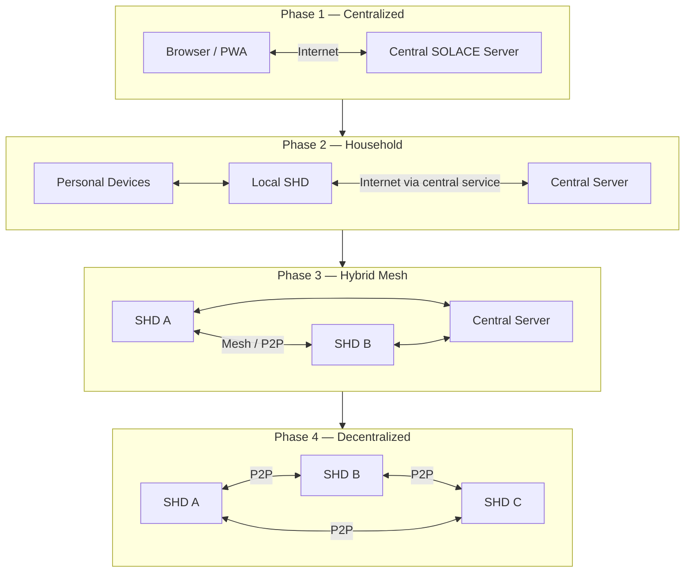

# SOLACE Network Overview

## Physical Network Topology 

Central server, SHDs, routers, radios, devices, sensors, and connectivity.

## SOLACE Network — Four-Phase Evolution

### Phase 1 — Centralized

Initial deployment

All applications are hosted on the central SOLACE Server and accessed through browsers. Some may support PWA installation and offline functionality. Data synchronizes with the central server.

### Phase 2 — Household computing

Applications run locally on SOLACE Home Devices or personal devices. Data is stored locally, with synchronization to the household SHD. SHDs use the central server for inter-household communication.

### Phase 3 — Hybrid mesh networking

OpenWrt-compatible networking equipment enables direct peer-to-peer communication between SHDs. The central server remains available for coordination and communication when appropriate.

### Phase 4 — Independent decentralized network

SHDs can discover, authenticate, and communicate with one another without depending on the central SOLACE Server. Centralized infrastructure is no longer required for network operation.

### How the network evolves

We should avoid designing Phase 1 in a way that makes Phase 4 impossible without rewriting the entire system.

Phase 3 provides the network transport: SHDs can exchange information over mesh links.

Phase 4 provides operational independence: SHDs no longer require the central server for discovery, identity verification, routing coordination, or essential services.

## Logical Architecture 

Applications, APIs, identity, databases, synchronization, and local-versus-remote services.