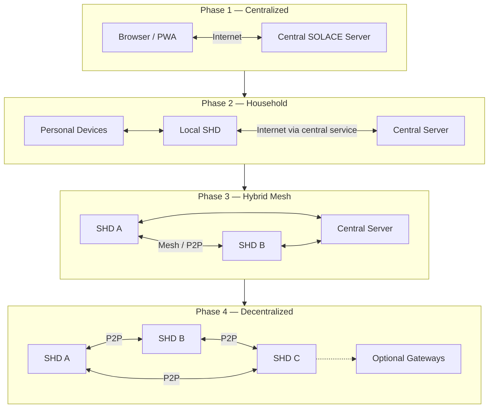
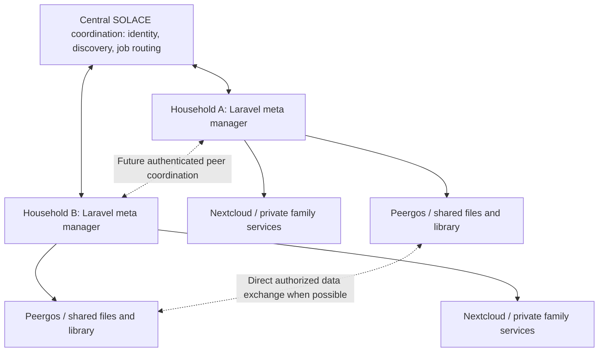
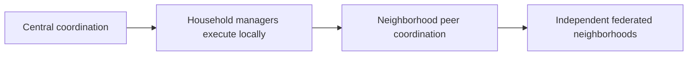

# SOLACE Network Overview

## 1. Purpose and Scope

SOLACE Network is a modular framework for connecting households and neighborhoods through software, locally operated computing devices, and eventually decentralized communication infrastructure.

The architecture is intended to evolve incrementally from centrally hosted applications into a network that can operate independently of any single server or organization.

The long-term goals include:

- Enabling households and neighborhoods to operate their own computing and communication infrastructure.
- Supporting communication and information sharing when conventional internet connectivity is unavailable or unreliable.
- Providing interoperable software and hardware standards that do not require purchasing official SOLACE equipment.
- Supporting local data storage, offline operation, and synchronization when connectivity becomes available.
- Allowing separately operated neighborhoods to communicate and cooperate without surrendering their independence.
- Building a foundation for applications involving household management, community collaboration, education, research, and shared knowledge.

**Core architectural principle:** Decisions made during the centralized phases should not unnecessarily prevent future decentralization.

This document describes the overall network architecture and its evolution. Detailed requirements for identity, governance, hardware, and individual applications belong in their respective technical specifications.

---

## 2. Network Terminology

### 2.1 Network identities

| Term | Meaning |
|---|---|
| NID | Neighborhood Identifier — identifies a SOLACE neighborhood |
| HID | Household Identifier — identifies a SOLACE household |
| MID | Member Identifier — identifies an individual member |

These identifiers represent logical identities rather than physical hardware or cryptographic keys.

A household may contain multiple members and operate multiple devices while retaining one HID.

An individual member may access the network while connected through infrastructure belonging to a different neighborhood.

### 2.2 Household devices

**SHD — SOLACE Home Device**

The generic term for a computer providing SOLACE household network services.

An SHD may run an official SOLACE installation or a compatible third-party implementation. SHD is a functional classification, not a required hardware brand.

**SOS — SOLACE OS**

The official SOLACE operating-system distribution or reference implementation intended for household devices.

The planned reference environment is based on Linux Mint Debian Edition (LMDE), with additional software and configuration for SOLACE services.

**SCD — SOLACE Compatible Device**

A independently assembled or third-party device that meets the compatibility requirements needed to participate in SOLACE Network.

An SCD does not have to run the official SOS distribution.

### 2.3 Other terminology

**SOLACE Home** refers to the household-management application, not the physical SHD.

**SOLACE Server** refers to the initially centralized server infrastructure.

**Gateway** refers to a service or device that facilitates communication, discovery, routing, or access between network participants or segments. Gateway responsibilities may evolve across phases.

**Network node** may be used generically when describing topology. SHD remains the preferred term when describing household computing equipment.

**Neighborhood mesh** refers to networking infrastructure connecting participating devices and households within an area.

**Guest access** refers to using another neighborhood's network infrastructure without becoming a member of that neighborhood.

---

## 3. Physical Network Topology

The proposed network includes several categories of equipment and connectivity.

### 3.1 Central SOLACE Server

During the initial phases, the central SOLACE Server hosts applications, membership services, APIs, and inter-household communication services.

The initial server architecture is based on:

- Linux server infrastructure.
- Apache HTTP Server.
- PHP and Laravel.
- MariaDB.
- Web-based account registration and authentication.
- APIs for applications and future SHD communication.

The central server is distinct from household devices and does not need to host household-specific services such as SOLACE Home or individual Nextcloud installations.

### 3.2 Household infrastructure

A household may operate an SHD connected to an OpenWrt-compatible router.

The SHD provides local applications, databases, storage, and network services.

The router provides connectivity between household devices and, in later phases, neighboring network infrastructure.

Other household equipment may include:

- Desktop and laptop computers.
- Smartphones and tablets.
- Wireless networking equipment.
- Sensors and monitoring devices.
- Locally connected smart-home equipment.
- Independent radio communication devices.

The reference topology treats the SHD and router as separate functional components, although future implementations could combine them.

Not every household must operate an SHD to use early SOLACE applications.

### 3.3 Radio communication

Separate low-bandwidth radio devices, including systems such as Meshtastic-compatible equipment, were discussed as potential additional communication channels.

Such radios may communicate independently of the SHD's ordinary IP network.

Possible future integrations include associating radio identities with SOLACE member identities and exchanging limited messages between network segments.

Specific radio protocols and integration requirements have not been finalized.

### 3.4 Physical connectivity

SOLACE may eventually communicate over multiple kinds of connections:

- Conventional internet connections.
- Local household wired and wireless networks.
- Neighborhood wireless mesh links.
- Direct peer-to-peer connections.
- Optional Foundation-operated and volunteer-operated gateways.
- Intermittent or opportunistic connections between disconnected network segments.

These methods need not all be available in every neighborhood.

---

## 4. Software and Service Architecture

### 4.1 Central versus household services

The central server and an SHD serve different purposes.

The central server initially supplies shared network services, public application hosting, membership functionality, and communication between households.

An SHD supplies local computing services and storage under the control of a household.

Although software components may share frameworks, APIs, data structures, or libraries, the central server and SHD should not be assumed to run identical application deployments.

### 4.2 SHD software stack

The planned SHD reference implementation uses Linux as the host operating system and Docker to package locally hosted services.

Possible service components include:

- Laravel/PHP application services.
- MariaDB.
- Web serving or reverse-proxy components.
- SOLACE household and network service APIs.
- Optional Nextcloud services.
- Optional Kiwix and offline knowledge resources.
- Other approved local applications or optional services.

Docker Compose was discussed as a practical method of managing the local service stack and supporting compatible installations on other Linux distributions.

The host operating system remains responsible for hardware support, network configuration, device management, and underlying service operation.

Containerized software does not itself provide mesh routing, resolve NAT traversal, or establish network trust.

### 4.3 Standalone applications

SOLACE applications should not necessarily require an SHD or permanent connection to the central server.

Where appropriate, applications may operate directly on an individual device, including as browser-based or installed Progressive Web Applications.

A local-first application could store data on the device and later synchronize with an SHD or another authorized service.

A household should be able to participate at a level appropriate to its available hardware and connectivity.

### 4.4 Optional services

The architecture should support additional components without making every service mandatory.

Examples discussed include offline knowledge libraries, local file sharing, and, in the long term, neighborhood-hosted AI services.

An optional service should not be assumed to exist on every SHD.

---

## 5. SOLACE Network — Four-Phase Evolution

### Phase 1 — Centralized

**Initial deployment**

All initial shared applications are hosted on the central SOLACE Server and accessed through web browsers.

Some applications may support PWA installation, local storage, or limited offline functionality.

Application and membership data are synchronized with, or managed by, the central server according to each application's requirements.

Key characteristics:

- Central application hosting and APIs.
- Web-based membership registration and authentication.
- Initial NID, HID, and MID identity records.
- Browser/PWA access without requiring an SHD.
- Early applications and shared data services.
- Architecture that anticipates later independent devices and decentralized identity.

The possibility of generating cryptographic identity keys during Phase 1 was discussed as a means of preparing for later independence. The exact key-management and account-recovery procedures require a separate specification.

### Phase 2 — Household Computing

Applications and services begin running locally on personal devices or SHDs.

Households gain local computing and storage capabilities while continuing to use the central server for communication between households.

Key characteristics:

- Locally hosted household services.
- Local application data and household storage.
- Synchronization between personal devices and an SHD where supported.
- Central-server-assisted inter-household communication.
- Authenticated SHD registration and network-status reporting.
- Development of SHD installation and compatibility standards.

A proposed early communication approach is for the SHD to initiate an outbound secure connection to the central server, allowing bidirectional communication without requiring inbound home-router port forwarding.

This approach is a potential implementation, not a finalized transport protocol.

### Phase 3 — Hybrid Mesh Networking

OpenWrt-compatible networking equipment enables direct communication between SHDs through neighborhood networking infrastructure.

The central server remains available for communication, coordination, or fallback when appropriate.

Key characteristics:

- Direct SHD-to-SHD communication over supported network links.
- Neighborhood mesh connectivity.
- Continued central-server interoperability.
- Authenticated guest access through participating neighborhood mesh infrastructure.
- Network status and connectivity measurements.
- Separation of household services, guest connectivity, and network routing responsibilities.

**Proposed Phase 3 policy:** Participating SOLACE mesh infrastructure provides a baseline level of authenticated guest connectivity.

This does not imply unrestricted access to private household networks, free general-purpose internet transit, or unlimited use of local resources.

### Phase 4 — Independent Decentralized Network

SHDs can discover, authenticate, and communicate with one another without depending on the central SOLACE Server.

The central server does not disappear. It may continue operating as an optional Foundation-operated gateway alongside independently operated gateways.

Key characteristics:

- Independent identity verification and communication.
- Peer-to-peer operation without mandatory central services.
- Optional Foundation and volunteer-operated gateways.
- Neighborhood and household independence.
- Local mesh operation even when conventional internet access is unavailable.
- Distributed or federated network presence and health information.
- Verified network coverage mapping.
- Configurable neighborhood guest-access policies.
- Support for multiple communication methods, including disconnected or intermittent network segments where practical.

**The distinction between Phase 3 and Phase 4 is architectural dependence.**

Phase 3 establishes direct physical communication paths.

Phase 4 eliminates the requirement for a central authority or server to perform essential network functions.

### 5.1 How the network evolves

The diagram illustrates the primary communication relationships, not a complete network routing specification.

---

## 6. Logical Architecture

### 6.1 Core services

The overall architecture anticipates several service categories:

- Identity and authentication.
- Household and neighborhood membership.
- Application APIs.
- Local application data storage.
- Authorized synchronization.
- Network discovery and connectivity.
- Communication and message exchange.
- Network presence and health monitoring.

Services may migrate from central hosting to household hosting or distributed operation as the phases progress.

They should be designed with clear boundaries rather than assuming permanent central deployment.

### 6.2 Stable identities and cryptographic authentication

NID, HID, and MID identifiers should remain stable independently of the credentials or cryptographic keys used to authenticate their authorized participants.

Cryptographic identities were proposed for all three identity levels.

The general direction is to support device-generated key pairs, registration of public verification information, key replacement or revocation, and authorized delegation of household or neighborhood responsibilities.

A neighborhood Captain or Head of Household acts on behalf of an entity but should not be treated as permanently identical to that entity.

Detailed key custody, device authorization, recovery, voting signatures, and delegation rules belong in `IDENTITY_AND_GOVERNANCE.md`.

### 6.3 Local and remote data

The location of application data will vary by phase and application.

Initial applications may rely on central databases, while later deployments may use device-local or SHD-local data stores.

Future synchronization mechanisms must account for connectivity interruptions, authorization, and changes occurring in more than one location.

The precise synchronization protocols and conflict-resolution rules remain to be specified.

### 6.4 Authentication versus connectivity

A network connection does not automatically authorize access to applications or data.

The architecture distinguishes:

1. **Network connectivity:** A device can communicate through available infrastructure.
2. **Identity authentication:** A device or member can demonstrate an authorized identity.
3. **Resource authorization:** The authenticated identity has permission to access a particular service or dataset.
4. **Neighborhood membership:** A household belongs to a particular NID for membership and governance purposes.

These concepts remain separate even when the same physical infrastructure supports all four.

---

## 7. Network Presence and Connectivity Status

### 7.1 SHD participation

An operating SHD can contribute to SOLACE even when no member is actively using the central website.

Running an authorized SHD is therefore considered a form of household participation.

An SHD might provide local services, connectivity, message relay, or other supported functions depending on its configuration and the network phase.

Household participation should not be measured exclusively by website logins.

### 7.2 Phase 2 heartbeat service

A proposed Phase 2 service would allow an SHD to periodically report authenticated connectivity status to a central API.

Potential reporting information includes:

- HID association.
- Authorized device identity.
- Reporting timestamp.
- Connectivity state.
- Optional advertised service capabilities.
- Authentication or cryptographic verification information.

The purpose is to identify operational SHDs, provide useful connection feedback, and support network-wide participation statistics.

The reporting mechanism should avoid unnecessarily exposing sensitive household information.

Specific heartbeat intervals, authentication details, retention policies, and API schemas remain undecided.

### 7.3 Presence versus activity

Several measurements must remain distinct:

**Household activity** represents qualifying participation by a household, including authorized SHD operation or member activity.

**SHD presence** indicates whether a device has recently reported or otherwise demonstrated network participation.

**Network reachability** indicates whether communication between relevant services or network endpoints succeeds.

**Wireless coverage** indicates areas where usable radio connectivity has been confirmed.

An online device does not automatically establish broad geographic coverage, and a missing heartbeat does not prove a household has abandoned the network.

### 7.4 Inactivity and communication

The Foundation may use membership activity records to identify households that have stopped participating and offer assistance or encouragement.

Extended inactivity may eventually affect governance eligibility under defined rules.

The network system should provide evidence of qualifying device activity, while the actual eligibility, notification, suspension, and reactivation rules belong in the identity and governance specification.

Temporary outages and disconnected mesh segments must be considered before interpreting a lack of activity reports.

---

## 8. Network Status Indicators

SOLACE applications may provide a simplified network-status interface similar to the signal indicator on a mobile phone.

The goal is to communicate network availability without requiring users to understand technical topology.

A status interface could distinguish:

- Local network signal or link quality.
- Whether an authorized SOLACE network connection has been established.
- Whether required SOLACE services are reachable.
- Whether the device is operating through a neighborhood mesh or another connection method.

Strong radio signal alone must not be treated as proof that authentication succeeded or that the user's requested services are reachable.

A status indicator should reflect usable, verified connectivity rather than the existence of nearby equipment.

The concept may evolve from a simple server connection indicator in Phase 2 to a broader connectivity indicator in Phases 3 and 4.

---

## 9. Guest Access Between Neighborhoods

### 9.1 Cross-neighborhood access

A SOLACE member may visit an area served by a different NID.

The member should be able to use authorized guest network connectivity without joining that NID or receiving access to private household resources.

For example:

- A member belongs to NID-A.
- The member encounters an available SOLACE mesh in NID-B.
- The member connects through the supported guest-access mechanism.
- The member authenticates using their SOLACE identity.
- The member accesses their own authorized SOLACE resources through available network paths.

The member's identity and home-neighborhood membership do not change because they use another neighborhood's infrastructure.

### 9.2 Guest access policies by phase

**Phase 3:** Baseline authenticated guest connectivity is proposed as a requirement for participating SOLACE mesh infrastructure, encouraging interoperability and network growth.

**Phase 4:** Guest connectivity becomes configurable by individual neighborhoods.

The decision to allow guest connectivity should remain separate from the decision to relay traffic between network segments.

### 9.3 Access restrictions

Guest access does not imply:

- Access to private household LAN resources.
- Access to another household's data.
- Automatic neighborhood membership.
- Unlimited bandwidth or storage.
- Mandatory sharing of a paid internet connection.

Guest connectivity, network transit, and resource-sharing permissions may have separate policies.

The exact guest authentication, service discovery, isolation, and bandwidth-management mechanisms remain to be specified.

---

## 10. Distributed Network Health and Coverage Mapping

### 10.1 Purpose

By Phase 4, SOLACE may support a network-level map showing confirmed connectivity and operational health.

The emphasis shifts from individual SHD reporting to regional network visibility.

The concept is similar to a mobile carrier's coverage map, adapted to decentralized and community-operated networks.

### 10.2 Confirmed coverage only

**The map should show verified operational coverage, not projected or promised coverage.**

A neighborhood's intention to build a mesh does not establish usable connectivity.

Coverage information must be supported by actual measurements or successfully observed network operation.

### 10.3 Possible views

- Confirmed geographic connectivity coverage.
- Network segments that are operational or degraded.
- Available gateway infrastructure.
- Reachability between participating network segments.
- Availability of supported network services.
- Historical changes in operational coverage, if sufficient verified observations are retained.

Each view should distinguish the type of measurement it represents.

### 10.4 Decentralized reporting

In Phase 4, SHDs and gateways may exchange authenticated network observations without requiring all telemetry to be sent to the Foundation.

A local neighborhood might maintain its own network-health view, while volunteer or Foundation-operated gateways could optionally aggregate broader regional information.

Participation and reporting policies must be compatible with the goal of decentralized operation.

### 10.5 Privacy

Network mapping should avoid publicly exposing precise private household locations, device activity histories, or sensitive infrastructure details.

Aggregated or generalized reporting may provide useful geographic information without revealing individual households.

Exact location-handling and publication rules remain to be determined.

---

## 11. Communication and Transport Independence

The network should not assume that every household has a continuous internet connection.

Potential communication paths include:

- Central-server-assisted communication.
- Direct local-network communication.
- Direct neighborhood mesh links.
- Optional gateway-mediated communication.
- Intermittent connections between network segments.
- Opportunistic message transfer using portable devices.

The long-term goal is to allow applications and messaging services to operate across supported transports without requiring each application to understand the physical network.

### 11.1 Delay-tolerant networking

A future concept involves using portable SOLACE devices as passive data carriers between disconnected neighborhoods.

For example, a phone may encounter one neighborhood mesh, receive permitted encrypted message bundles, travel to another neighborhood, and forward the bundles when a compatible connection becomes available.

This could enable communication even when no continuous physical or internet route connects the two NIDs.

Such a system would require further work involving:

- End-to-end message confidentiality.
- Message identification and duplicate detection.
- Delivery acknowledgments.
- Message expiration and storage limits.
- Routing and forwarding policies.
- Device authorization and trust.
- Battery and storage limitations.
- Mobile operating-system restrictions on passive networking.

**Status: Future research and design.**

The use of mobile data mules is an architectural possibility, not an implemented or finalized messaging protocol.

Detailed implementation requirements belong in a future communication specification or the Parking Lot.

---

## 12. Foundation and Community Infrastructure

The SOLACE Foundation and the central SOLACE Server are distinct concepts.

The Foundation is the proposed organizational steward of SOLACE Network.

The central server is one technical deployment that may provide shared services.

During the centralized phases, the central server plays an essential technical role.

In Phase 4, households and neighborhoods should not require that particular deployment to remain operational.

Other operators may provide compatible gateways or supporting services, subject to the eventual interoperability and trust requirements.

The architecture should not make the Foundation-operated gateway the sole route, sole identity authority, or sole point of failure for decentralized operation.

---

## 13. Architectural Principles

The following principles summarize the direction established during planning.

1. **Incremental evolution:** Build a working centralized system first while preserving a path to decentralization.
2. **Local independence:** Households should increasingly control their own applications, services, and data.
3. **Open interoperability:** Official hardware should not be mandatory for participation.
4. **Clear identity boundaries:** Members, households, neighborhoods, and devices are distinct entities.
5. **Transport independence:** Communication should not remain permanently tied to one server or physical connection method.
6. **Optional infrastructure:** The mature network may use central and volunteer services without depending on any one of them.
7. **Authenticated access:** Connectivity alone does not grant access to private resources.
8. **Shared connectivity:** Guest access can extend network usefulness beyond a member's home neighborhood.
9. **Measured status:** Network maps and indicators should represent observed operational conditions rather than speculative availability.
10. **Privacy-conscious reporting:** Network monitoring should provide useful information without unnecessarily exposing households or devices.
11. **Modular deployment:** Individual applications and optional services should not all be required to operate an SHD.
12. **Offline resilience:** Applications and communication services should account for interrupted or unavailable connectivity.

---

## 14. Open Architecture Questions

The following issues have been identified but are not yet finalized:

- Exact SHD registration and authentication workflow.
- Identity-key generation, rotation, delegation, and recovery mechanisms.
- Central-server-to-SHD transport and connection lifecycle.
- Household synchronization protocols and conflict handling.
- Mesh network configuration and interoperability requirements.
- Gateway discovery and trust relationships.
- Guest access, transit, and resource-sharing policy enforcement.
- Measurement standards for signal quality and verified coverage.
- Network-health telemetry intervals and retention.
- Operation during prolonged network partitions.
- Distributed presence and regional health-data aggregation.
- Detailed delay-tolerant messaging and mobile data-mule protocols.

These questions should be addressed in appropriate phase-specific specifications and implementation milestones.

---

## Proposed Household Meta-Manager and Service Architecture

A proposed architectural direction is for **each SHD to run a local Laravel-based meta manager**, coordinating household services and accepting authorized work from other household managers. The central SOLACE Server initially assists with identity, discovery, routing, and cross-household coordination, but should not be required to process every file or perform every local task.

### Capability-oriented integration

SOS applications should expose familiar tasks—**Home, Family, Files, Neighborhood, Library**—rather than require users to operate separate third-party interfaces. The manager can use service adapters for capabilities such as files, calendars, contacts, messaging, and search. Nextcloud is a candidate for locally hosted family organization; Peergos is a candidate for distributed file sharing and shared libraries. Both are **proposed integrations**, not mandatory components or confirmed interoperability.

Example: a member selects a document in SOLACE Library and chooses **Share with Neighbor**. The local manager records the requested operation, obtains authorized access to the source, coordinates with the destination household, delegates transfers to appropriate services, verifies results, and reports status. The user should not need to understand which services executed the steps.

### Durable cross-household work

Laravel queues, scheduled jobs, and local persistence can support retries and reconciliation. A proposed cross-household protocol should distinguish **requested**, **accepted**, **in progress**, **delivered**, **verified**, and **failed** states as appropriate. Jobs need stable IDs, authenticated authorization, idempotent handlers, bounded retries, expiration, and recovery after interrupted connectivity. A queue acknowledgment is not proof that a recipient received or can open a file.

The central coordinator may relay *control messages* without carrying file payloads. Household managers remain authoritative for their own local operations and must validate authorization independently. Private household data should remain private by default; publishing or sharing is an explicit action.

### Portable identity and guest-device access

A member may sign into `solace.network` from a guest browser on another household's computer and request authorized access to services hosted on their own SHD. The local Linux guest identity, SOLACE member identity, and remote household authority are distinct. Discovery and secure routing may initially use central infrastructure; the home node still enforces access controls. Short-lived sessions and removal of guest browser state are important safeguards.

### Evolution toward independence

The long-term aim is to remove the **central server as a required dependency**, not necessarily to prohibit optional public bootstrap, directory, or gateway services. Local household functions should continue when the central service is unavailable; later phases should test peer discovery, identity verification, job coordination, and service access during internet outages and network partitions. Decentralized identity, trust, revocation, and recovery remain unresolved design challenges.

---

## 15. Related Documentation

- [Vision](VISION.md) — Long-term purpose and aspirations.
- [Identity and Governance](IDENTITY_AND_GOVERNANCE.md) — Members, households, neighborhoods, authentication, and governance.
- [Hardware](HARDWARE.md) — Device configurations and infrastructure requirements.
- [Roadmap](ROADMAP.md) — High-level development milestones.
- [Parking Lot](PARKING_LOT.md) — Deferred research and potential future capabilities.

Application-specific behavior, requirements, and data models are documented in their respective repositories.